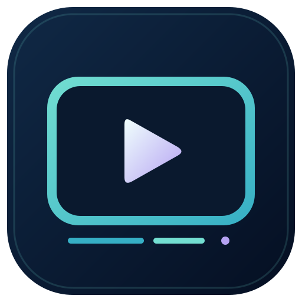

# Corte · Krew

Editor local de recortes de video para Windows 10/11 de 64 bits.

**[Descargar la última versión](https://github.com/somoskrewhub/corte-releases/releases/latest)**

Descargá `Corte-Instalar-X.Y.Z.exe` desde la sección Assets de la versión e instalalo. El acceso directo Corte queda en el escritorio y en Inicio.

- YouTube y Shorts, Instagram Reels, TikTok y Facebook Reels públicos, incluidos enlaces compartidos.
- Marcas de inicio y fin sobre una línea de tiempo. Para Instagram, TikTok y Facebook, la vista previa opcional descarga una copia completa, de menor calidad cuando está disponible, para marcar desde la reproducción. Se puede descargar directamente sin esa copia.
- Hasta diez recortes o el video completo, MP4 con el audio original si tiene, hasta 1080p según disponibilidad. Se conserva la orientación vertical.
- Procesamiento en tu computadora, sin servidor contratado ni suscripción de Corte.
- Al abrir, Corte consulta GitHub y recomienda descargar una versión nueva. También podés usar **Actualizar Corte**. La instalación se hace cuando vos la elegís.
- **⋯ → Actualizar motor de video** actualiza el componente de descarga por separado.

Prepará la descarga y guardá los archivos en tu computadora antes de cerrar o actualizar. Se necesita conexión a Internet para los videos y para buscar actualizaciones. No se admiten publicaciones privadas, que exijan iniciar sesión, fotos, carruseles o transmisiones en vivo. La disponibilidad depende de cada plataforma.

Este repositorio público distribuye instaladores, notas de versión y licencias de componentes externos. El repositorio del código de Corte es privado.

## Integridad y componentes

Cada versión incluye `SHA256SUMS.txt`. Corte verifica la integridad del instalador antes de permitir instalarlo. Los binarios no llevan certificado comercial de firma de código.

Las licencias y fuentes de los componentes externos están referenciadas en [licenses/COMPONENTES.txt](licenses/COMPONENTES.txt). Electron, Node.js, yt-dlp, FFmpeg y Montserrat conservan sus respectivas licencias. Estos avisos también se incluyen en la instalación.
